# TOHEŞAR — Next Generation

The homepage, Cinematic World and Se-diyu exhibition have been rebuilt as three connected experiences. The first homepage viewport now opens inside a bright coastal photograph. A new sunlit architectural harbour replaces the previous 3D environment, and a precisely beveled brushed-metal sculpture replaces the previous symbol presentation.

The established wordmark and all 67 approved silhouette coordinates are preserved. The three original entrypoints are archived verbatim; 117 original source, asset and license files remain unchanged. Production main is not modified or merged.

## Desktop comparison

| Experience | Before | After |
| --- | --- | --- |
| Home | 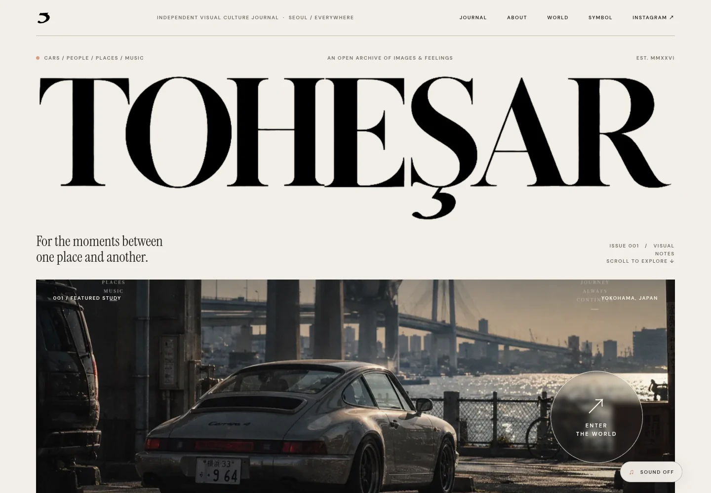 | 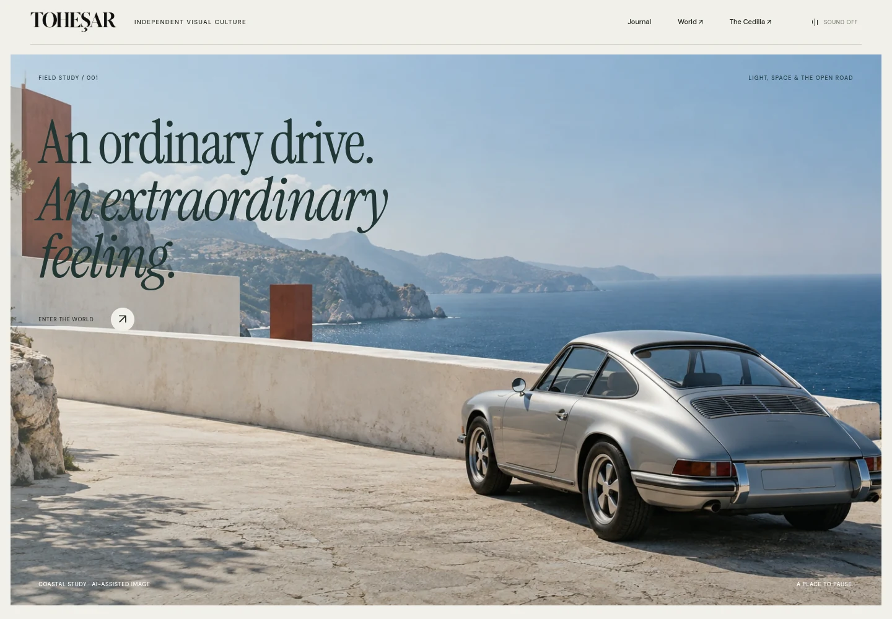 |
| World | 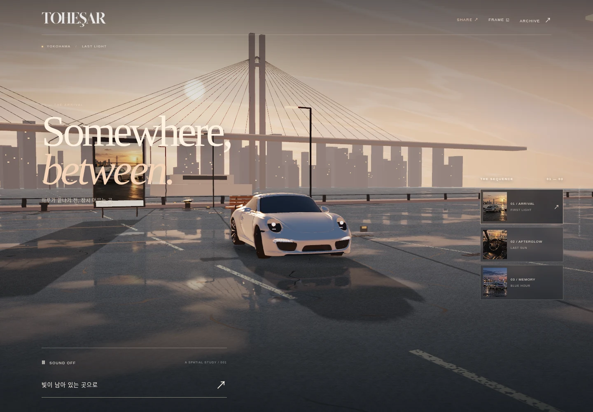 | 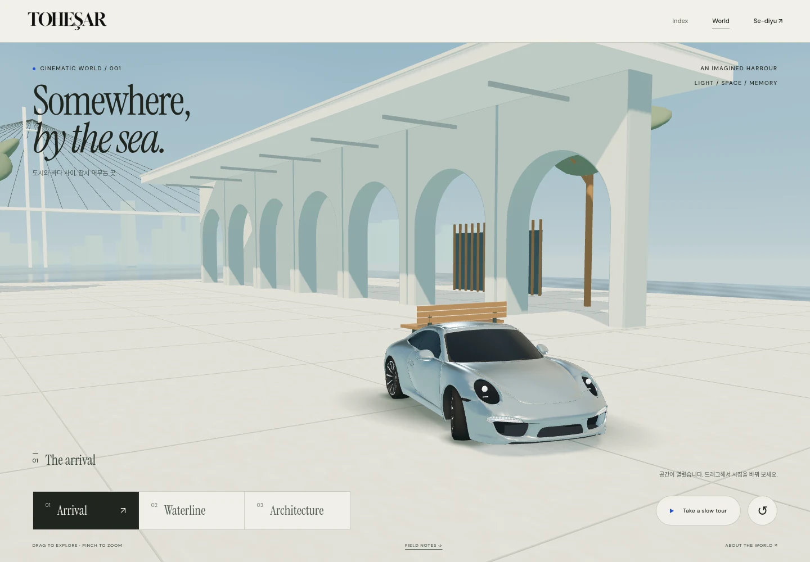 |
| Se-diyu | 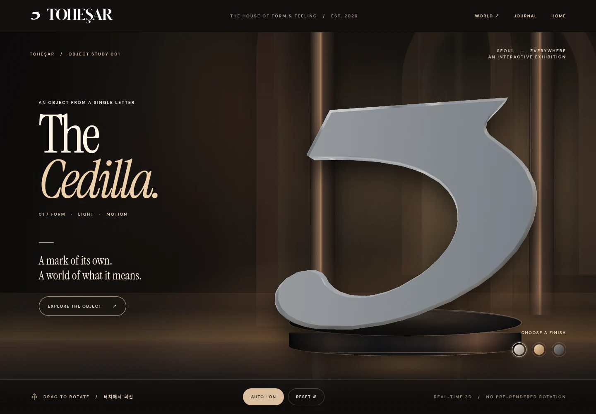 | 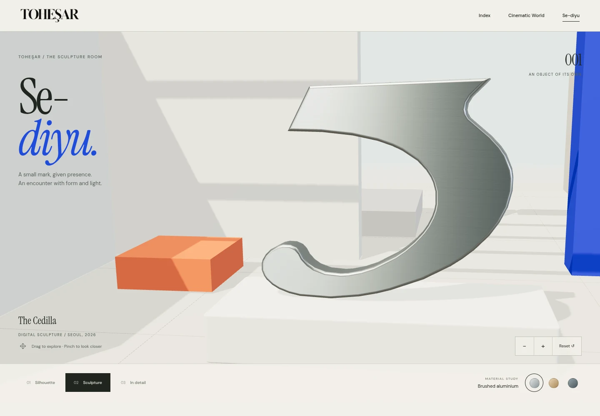 |

## Mobile comparison

| Experience | Before | After |
| --- | --- | --- |
| Home | 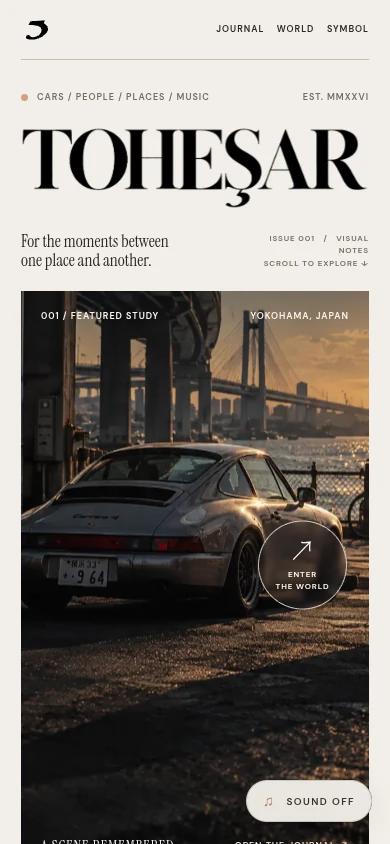 | 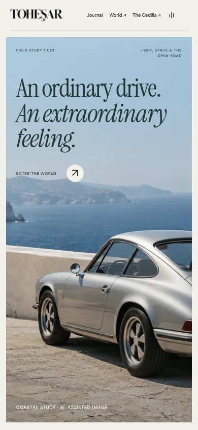 |
| World | 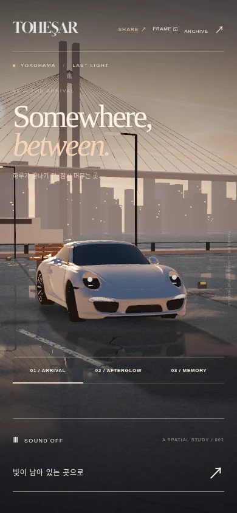 | 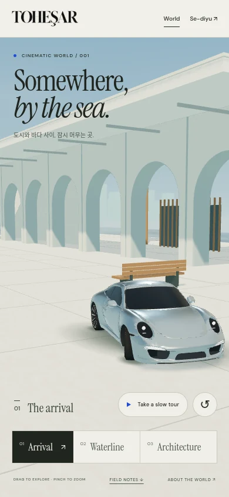 |
| Se-diyu | 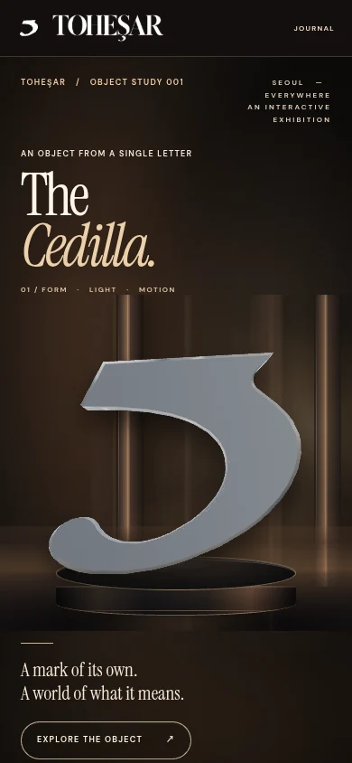 | 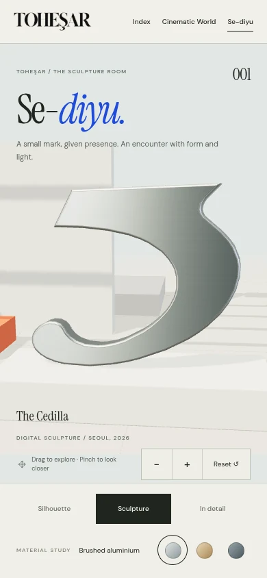 |

[Complete desktop homepage](screenshots/after-home-desktop-full.webp) · [Complete mobile homepage](screenshots/after-home-mobile-full.webp)

## Implemented behavior

- Homepage: new coastal visual study, responsive editorial composition, preserved visual journal, real WebGL exhibition previews, opt-in music, keyboard navigation and reduced-motion enhancement.
- World: new open stone arcades, terracotta pavilion, coastal trees, quay, distant harbour, reflecting water, existing licensed 911, three camera compositions, slow tour, drag/pinch/keyboard exploration, field-notes link and visible credits.
- Se-diyu: exact approved contour, inward nine-segment bevel, authentic studio reflections, fine brushing and anisotropy, full architectural exhibition with stone plinth, silhouette/sculpture/detail views, three metal finishes, drag/pinch and explicit zoom controls. Detail view removes surrounding copy for unobstructed inspection.
- Both scenes: local Three.js modules/fonts, responsive rendering budgets, hidden/offscreen suspension, graceful loading/unsupported/context-loss fallback, fresh environment generation on context restoration and complete GPU release on departure.

## Verification

| Check | Result | Evidence |
| --- | --- | --- |
| Chromium, desktop/mobile | 16/16 passed | [Report](verification/chromium.json) |
| WebKit 26.5, desktop/mobile | 16/16 verified, including two corrected restoration reruns | [Consolidated report](verification/webkit.json) |
| Exact source preservation | 3 original entrypoints, 67 outline points, 117 original files unchanged | `node tests/source-integrity.mjs` |
| Small portrait / landscape | 375×667 and 844×390 inspected; controls visible | [World portrait](screenshots/world-compact.webp) · [World landscape](screenshots/world-landscape.webp) · [Sculpture portrait](screenshots/symbol-compact.webp) · [Sculpture landscape](screenshots/symbol-landscape.webp) |

Browser acceptance checks cover actual WebGL initialization and drawn geometry, GL error state, responsive overflow, resource failures, camera and material controls, keyboard and touch emulation, license dialog, reduced motion, unavailable WebGL, unavailable dependencies, context loss/restoration and GPU resource disposal. Both scenes recover with GL error 0 and release GPU geometry/textures to 0.

A real WebKit recovery defect was found and fixed: disposing a prior PMREM target after native context reset attempted to delete GPU objects from the old context. Targets are now disposed while the context is lost, then regenerated after restoration. [Initial failing report](verification/webkit-initial-before-recovery-fix.json) and [corrective rerun](verification/webkit-recovery-rerun.json) are retained for traceability.

Screenshots were inspected against the baseline. The final review captures use reduced motion for stable framing. Chromium uses software WebGL in this environment; measured timings are not a physical-device performance benchmark. Linux WebKit and mobile emulation do not establish verification on a physical iPhone or macOS/iOS Safari. Those physical-device checks remain a release-review item.

## Preview and recovery

```sh
python3 -m http.server 8080
node tests/source-integrity.mjs
node tests/browser.mjs
```

Visit `/`, `/world/` and `/symbol/` through the static server. Browser checks need Playwright and a Chromium installation; see the test header for environment configuration. No application build or external runtime CDN is required. `CNAME` is preserved.

Follow [PROGRESS.md](../../PROGRESS.md) to recover from the pushed checkpoint branch. Asset sources and licenses: [Next Generation provenance](../../next-generation/ASSET_PROVENANCE.md), [original model provenance](../../world/ASSET_PROVENANCE.md). The new coastal image is explicitly labeled as AI-assisted; real-time previews are captures of the actual new scenes.
