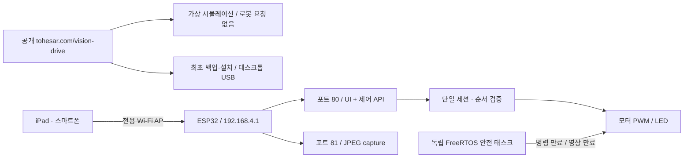

# VISION DRIVE 04 — 설계 근거와 제약

## 선택한 구조

공개 HTTPS 사이트에서 HTTP 로봇을 직접 제어하는 방식은 혼합 콘텐츠, 로컬 네트워크 권한과 학교망의 단말 격리 정책에 좌우된다. 기존 C# 브리지는 노트북 서버를 계속 켜야 하며, 노트북이 끊겼을 때 제조사 로봇 자체가 마지막 출력을 내리지 않는다. 학교 STA는 자격 증명·가변 IP·망 격리 문제를 남긴다.

따라서 로봇 AP + 로봇이 직접 제공하는 같은 출처 UI를 채택했다. IP를 192.168.4.1로 고정하고 AP만 켠다. 학교 Wi-Fi 설정·클라우드 중계·노트북 실행 파일·외부 CDN이 없다. 단점은 인터넷 동시 사용 불가, 제한된 2.4 GHz 대역폭, AP 동시 단말 1대, 브라우저의 ‘인터넷 없음’ 자동 전환을 확인해야 한다는 점이다. AP 공용 암호는 교실용이다. 공공망 원격 제어 서비스가 아니며 암호를 아는 주변 단말에 대한 완전한 보안 격리를 제공하지 않는다.

## 실제 하드웨어 근거

공식 KS5023 `11_4_Video_Car.ino`와 PDF를 보관했다.

| 기능 | GPIO | 논리 |
|---|---|---|
| 왼쪽 H bridge | 13 / 12 | 전진 13 PWM, 12 LOW / 후진 반대 |
| 오른쪽 H bridge | 14 / 15 | 전진 14 LOW, 15 PWM / 후진 반대 |
| 카메라 LED | 4 | HIGH on, LOW off |
| Camera XCLK | 0 | LEDC channel 0 / timer 0 |
| Camera SCCB | 26 / 27 | SDA / SCL |
| Camera data | 5,18,19,21,36,39,34,35 | D0…D7 |
| Camera timing | 25 / 23 / 22 | VSYNC / HREF / PCLK |
| Camera power-down | 32 | reset pin -1 |

- GPIO 12·15는 부트 스트랩과 관련되고 12~15는 SD 기능과 공유된다. SD 카드를 사용하지 않으며 다른 모듈을 연결하지 않는다. 실제 확장 보드가 공식 배선과 같은지 실기 전 확인한다.
- 모터는 카메라 LEDC와 다른 Arduino 채널 4~7을 사용한다. PWM 1 kHz / 8 bit. 부호 반전 때 두 H bridge 입력을 먼저 0으로 내리고 5 ms 후 새 방향을 적용한다. 이 시간은 실물 드라이버의 전기적 검증을 대체하지 않는다.
- 카메라는 안정성과 메모리를 우선해 QVGA 320×240, JPEG quality 14, 프레임 버퍼 1개. PSRAM이 있으면 PSRAM, 없으면 DRAM을 사용한다. VGA를 무조건 요구하지 않는다.
- ESP32-CAM의 플래시 4 MB를 전제로 `huge_app.csv`를 사용한다. OTA를 넣지 않았고 SD/LittleFS 업로드도 필요 없다. UI gzip 배열이 앱 바이너리에 포함된다.
- 제조사 예제의 브라운아웃 감지 해제 코드를 옮기지 않았다. 저전압 리셋은 전원을 고쳐 해결해야 한다. 모터 전원 간섭과 최대 전류는 현장 검증이 필요하다.

## 제어와 실패 모델

HTTP 제어와 카메라를 서로 다른 ESP HTTP 서버 태스크/포트에 분리했다. UI는 제어 요청을 하나만 진행하고 80 ms 간격으로 현재 좌우 PWM과 LED 상태 전체를 전송한다. 클릭마다 증분 속도를 보내는 방식과 무제한 큐를 쓰지 않는다. HTTP 구현은 기본 ESP-IDF 구성에 포함되므로 추가 Async/WebSocket 런타임 의존성을 피한다. 실제 지연·프레임률은 아직 측정하지 않았다.

- 구동 준비: 최근 카메라 전송, 제어권 없음, 임의 31 bit 세션 토큰 발급, 출력 0.
- 각 명령: 세션 일치·증가 시퀀스·정수 범위 검증. 모든 좌우 값은 -255…255, LED 0/1.
- STOP: 세션·시퀀스 폐기, 모터 입력 0, LED OFF. 뒤늦은 이전 명령으로 출발할 수 없다.
- 350 ms 동안 유효 명령이 없으면 독립 우선순위 5 태스크가 동일하게 정지·폐기한다. 태스크는 10 ms 간격이고 5 ms 반전 지연/스케줄 지연이 추가될 수 있다.
- 마지막 전송 프레임이 1200 ms 이상 오래되면 기기에서도 만료한다. UI는 마지막 디코딩 프레임 900~1000 ms 경과 및 카메라 응답 오류 때 잠근다.
- 브라우저 제어 응답 제한 250 ms. 늦은 응답은 epoch 검사로 잠금 상태를 되돌리지 못한다.
- 창 이탈·숨김·페이지 종료·도움말·전체 화면 전환은 정지·잠금. 복귀 후 수동 구동 준비.
- 안전 태스크 자체의 진행은 ESP task watchdog(3초)으로 감시한다. 이것은 350 ms 통신 만료 태스크의 대체물이 아니며, CPU/전원/드라이버 고장의 모든 유형을 막지 않는다.

350 ms는 마지막 유효 명령 이후 소프트웨어 출력 0 기준이다. 기계적 정지 거리·모터 회전·H bridge 상태를 측정하는 센서는 없다. ESP32 CPU와 같은 전원에 의존하므로 물리적 전원 스위치를 사용할 수 있어야 한다. 순간 부트 스트랩 레벨과 전원 고장은 펌웨어만으로 완전히 보장하지 못한다.

## 영상 계약을 바꾼 이유

원본 MJPEG ``는 브라우저가 프레임 갱신을 직접 관찰하기 어렵다. 원본 제조사 코드에는 `fb->width > 400`일 때만 JPEG 길이를 설정하는 분기가 있어 저해상도 전송도 취약하다. 새 구현은 JPEG 응답을 하나씩 받아 디코딩 완료를 관찰하고 다음 프레임을 요청한다. 서버는 성공한 전송 시각을 기록한다. 프레임에 신규 영상 내용이 있다는 센서 증명은 아니므로 영상 앞에서 손을 움직이는 현장 확인도 필요하다. 동일한 장면의 프레임 비교로 ‘실시간’을 추정하지 않는다.

포트 81의 CORS는 `http://192.168.4.1`만 허용한다. 포트 80 변경 API는 JSON POST만 받고 브라우저 Origin이 있으면 같은 로봇 Origin을 요구한다. 공개 사이트에는 로봇 주소로 연결되는 fetch가 실행되지 않는다. 공개 시뮬레이터에는 가상 경로만 있고 로봇 통신 모드를 사용자가 켜는 스위치도 없다.

## 최초 설치와 복원

일상적인 조종에는 USB가 필요 없다. 그러나 기존 펌웨어에 없는 AP·새 UI·기기 자체 안전 정지를 추가하려면 **최초 한 번 펌웨어 교체**가 필요하다. 플래시를 쓰기 전 같은 기기의 4 MB 전체 데이터를 읽고 MD5 검증·SHA-256 보관 파일 대조를 수행한다. 복원은 MAC·크기·SHA-256 일치를 요구하고, 기록 뒤 다시 읽어 검증한다.

esptool-js 0.5.7의 readFlash 소스를 검토하며 후미 digest 미소비 및 누적 버퍼 복사를 확인했다. `flash-io.js`는 같은 stub 프로토콜을 고정 크기 버퍼로 읽고, 모든 ACK 뒤 최종 16 byte MD5를 반드시 소비·비교한다. 실제 esptool-js와 합성 시리얼 패킷으로 이 동작을 시험했다. 이것도 USB 전기적 통신·실물 부트 진입 검증은 아니다.

백업은 기존 Wi-Fi 자격 증명을 포함할 수 있다. 서버로 올리지 않고 브라우저에서 파일로 저장하며 공개 소스 패키지에도 기기 백업을 넣지 않았다. 제조사 예제 소스는 정확한 기존 설치 상태의 백업이 아니고, 본 작업에서 실제 기기의 백업을 읽은 적도 없다.